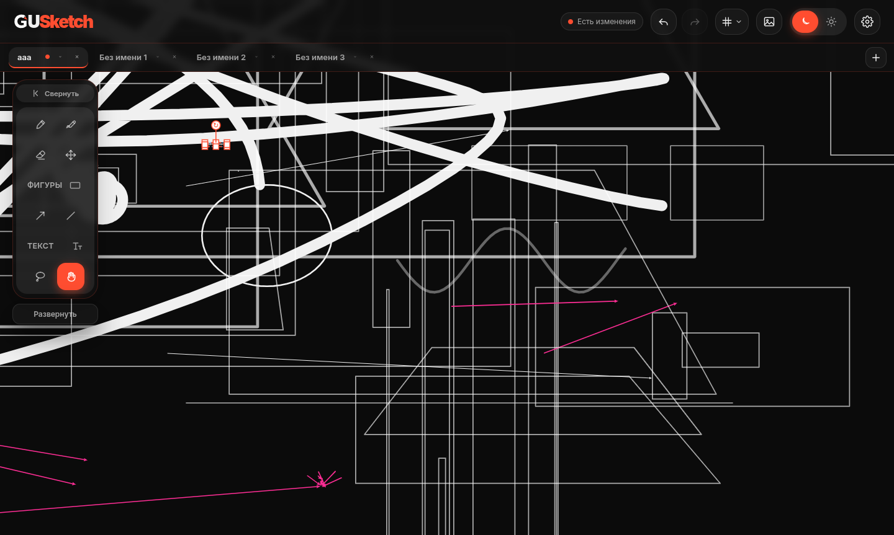

# GUSketch — рисование, заметки и доски

GUSketch — десктопное приложение для рисования, заметок и визуального планирования. Оно соединяет свободный холст в духе Figma с организацией материалов по разделам и листам в духе OneNote. Работает локально: проекты хранятся в обычной системной папке, без аккаунта и облака.

- **Сайт проекта:** <https://projects.guteam.net/gusketch>
- **Документация:** <https://doc.guteam.net/gusketch>
- **Релизы:** <https://github.com/GreatUserTeam/gusketch/releases>
- **Сайт команды:** <https://guteam.net>



## Возможности

- **Свободный холст** с зумом от 10% до 800%, панорамированием и настраиваемой сеткой.
- **Рисование пером и мышью:** кисть с поддержкой давления графического планшета, полупрозрачный маркер, ластик по объектам и «дырявый» ластик.
- **Векторные объекты:** прямоугольники, круги, линии, стрелки и текст. Объекты можно выделять, перемещать, масштабировать, поворачивать и менять их порядок.
- **Разделы и листы:** каждая вкладка — отдельный проект (файл `.gusketch`), внутри вкладки можно создавать любое количество листов.
- **Изображения:** вставка из файла или буфера обмена, перемещение и масштабирование вместе с остальными объектами.
- **Экспорт:** PNG с прозрачным или белым фоном, PDF текущего листа и PDF всех листов, копирование изображения в буфер обмена.
- **Автосохранение** каждые 5 секунд по умолчанию, восстановление вкладок при запуске и наблюдение за системной папкой проектов.
- **Оформление:** тёмная, светлая и системная тема, акцентный цвет, масштаб интерфейса, русский и английский языки.
- **Локальность:** все данные остаются на устройстве. Приложение не отправляет содержимое проектов в сеть.

## Платформы

| Платформа | Форматы | Статус в 1.0.0 |
| --- | --- | --- |
| Linux x86_64 | `.AppImage`, `.deb`, `.rpm` | Опубликованы |
| Windows 10/11 x64 | NSIS, portable | Конфигурация сборки готова, бинарная сборка появится позже |

## Установка

### Linux

Debian/Ubuntu:

```bash
sudo dpkg -i GUSketch_1.0.0_amd64.deb
```

Fedora/RHEL/openSUSE:

```bash
sudo rpm -i GUSketch-1.0.0-1.x86_64.rpm
```

AppImage не требует установки:

```bash
chmod +x GUSketch_1.0.0_amd64.AppImage
./GUSketch_1.0.0_amd64.AppImage
```

### Windows

В релизе 1.0.0 готовой Windows-сборки нет. Конфигурация `electron-builder` для NSIS и portable уже находится в `package.json`; собрать установщик можно командой `npm run build:win` на Windows или в среде с Wine.

## Формат `.gusketch`

Один проект — один ZIP-архив с расширением `.gusketch`:

```text
project.gusketch
├── document.json   # листы, объекты, камера и сетка
├── meta.json       # версия формата, приложение, даты
├── preview.png     # превью первого листа для вкладки
└── images/         # вставленные изображения
```

`document.json` хранит массив листов. В каждом листе есть `id`, `name`, `strokes`, `view` (зум и смещение камеры), `grid` и `meta`. Объекты описаны обычным JSON: тип, координаты, размеры, цвет, толщина и дополнительные параметры. Версия формата — `1.0`.

## Где хранятся проекты

| Платформа | Путь |
| --- | --- |
| Linux | `~/.local/share/GUSketch/Projects` или `$XDG_DATA_HOME/GUSketch/Projects` |
| Windows | `%APPDATA%\GUSketch\Projects` |
| macOS | `~/Library/Application Support/GUSketch/Projects` |

Путь можно переопределить переменной окружения `GUSKETCH_PROJECTS_DIR`. Настройки, сессия и порядок вкладок лежат в каталоге данных приложения (`~/.config/GUSketch` на Linux).

## Горячие клавиши

| Действие | Клавиши |
| --- | --- |
| Кисть / маркер / ластик | `B` / `M` / `E` |
| Перемещение / лассо / рука | `V` / `Q` / `H` |
| Прямоугольник / круг / фигуры | `R` / `O` / `S` |
| Линия / стрелка / текст | `L` / `A` / `T` |
| Временная рука | `Пробел` |
| Новая вкладка / новый лист | `Ctrl+T` / `Ctrl+Shift+N` |
| Сохранить / сохранить всё | `Ctrl+S` / `Ctrl+Alt+S` |
| Отменить / повторить | `Ctrl+Z` / `Ctrl+Shift+Z` |
| Зум / сброс зума | `Ctrl++`, `Ctrl+-` / `Ctrl+0` |
| Экспорт PNG | `Ctrl+E` |
| Копировать выделение / изображение | `Ctrl+C` / `Ctrl+Shift+C` |
| Вставить / дублировать / удалить | `Ctrl+V` / `Ctrl+D` / `Delete` |

## Сборка

Требуются Node.js 20+ и npm.

```bash
npm install
npm start          # запуск в режиме разработки
npm run build:linux # AppImage, deb и rpm
npm run build:win   # NSIS и portable (нужен Windows или Wine)
```

Готовые файлы попадают в `dist/`. Иконки находятся в `build/icons`, ресурсы сборки — в `build/`.

## Архитектура

```text
main.js            Electron main process: окно, меню, трей, IPC, протокол app://
preload.js         contextBridge: безопасный API для renderer
renderer.js        точка входа, связывает модули и горячие клавиши
index.html         разметка интерфейса
style.css          оформление и темы
src/state.js       состояние приложения и документов
src/board.js       холст, камера, отрисовка и интерактивный кэш
src/tools.js       инструменты рисования и преобразования объектов
src/selection.js   выделение, копирование и вставка
src/history.js     undo/redo
src/storage.js     формат .gusketch, автосохранение и системная папка
src/export.js      экспорт PNG/PDF
src/settings.js    настройки и палитры
src/tabs.js        вкладки и листы
src/panel.js       панель параметров инструмента
src/i18n.js        русский и английский интерфейс
```

Renderer работает без доступа к Node.js: `contextIsolation` и `sandbox` включены, все файловые операции проходят через IPC. Для загрузки ES-модулей main process регистрирует привилегированную схему `app://`, потому что `file://` блокирует модули из-за CORS.

## Приватность

- Приложение не содержит аккаунтов, телеметрии и сетевых запросов.
- Проекты, настройки и изображения хранятся только на устройстве.
- Внешние ссылки открываются в системном браузере через `shell.openExternal`.
- Буфер обмена используется только по явной команде пользователя.

## Лицензия

Проект распространяется под лицензией [MIT](LICENSE).

## Версия

`1.0.0` · Electron 44 · формат `.gusketch` 1.0 · Linux x86_64 · by [guteam.net](https://guteam.net)

coder @TigranKrapivin
